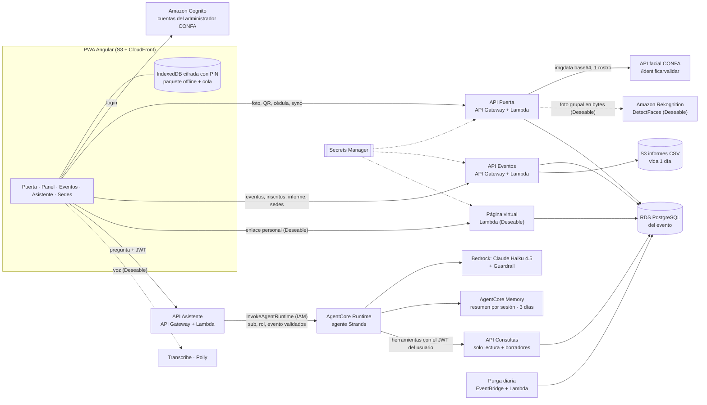
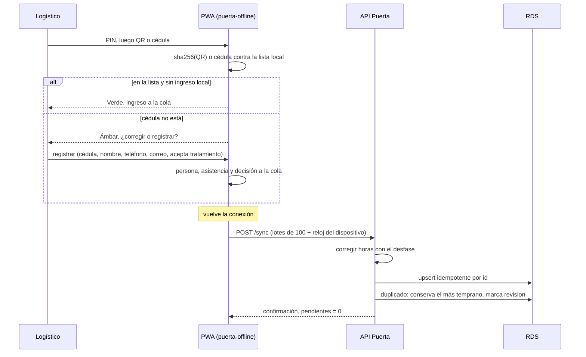
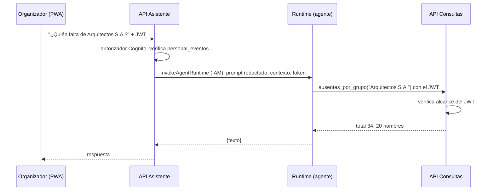
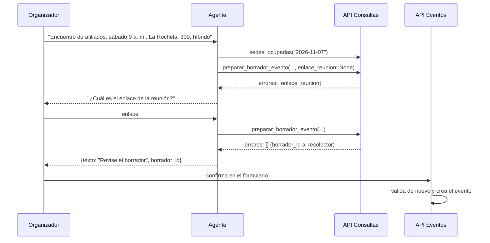

# Diseño: Pase CONFA

> v4 (4 nov 2026). Incorpora el contrato real de la API facial de CONFA, el frontend en Angular, los Requisitos 16 y 17 y las correcciones de las dos rondas de auditoría (`docs/auditorias/2026-11-04-*.md`). Lo marcado [supuesto] o [verificar] se confirma en el kickoff o en la cuenta del evento.

## Resumen
Una aplicación web instalable (PWA) para el personal logístico y los organizadores, con tres ideas de diseño:

- **La puerta es código, no IA.** Foto, QR o cédula → identificar → reglas → marcar asistencia. Es determinista, tarda segundos y no depende de un LLM.
- **La puerta funciona sin internet.** El dispositivo descarga el evento antes de abrir la puerta y valida QR y cédula localmente; sincroniza al volver la señal. El rostro depende de la API facial remota de CONFA, así que sin conexión no se ofrece.
- **El asistente de eventos es un agente.** Un solo agente Strands en AgentCore Runtime responde consultas y reportes, y prepara borradores de eventos desde una frase. Las cifras salen de herramientas; los borradores los valida código y los publica una persona.

El añadido (solicitud y aprobación de sedes) es código con una tabla de estados y una persona que decide; no usa IA.

## Arquitectura


## Alcance MVP y Deseable
| Prioridad | Requisitos | Componentes |
|---|---|---|
| **MVP** (hoy 4:00 p. m.) | 1–9, 11, 13, 14 (sin 2.5, 7.5, 7.8 ni 9.6) | PWA con modos logístico y punto fijo, `puerta-offline` (un dispositivo), `ClienteFacial`, API Puerta, API Eventos (eventos externos e internos, CSV, QR descargables), API Consultas, API Asistente, agente con `contar_asistencia`, `ausentes_por_grupo`, `estado_de_persona`, `resumen_novedades` y `generar_informe`, Memory, Guardrail, Cognito, Purga |
| **Deseable** | 2.5, 7.5, 7.8, 9.6, 10, 12, 15, 16, 17 | QR por correo (SES); sincronización entre dispositivos y registro offline; pasadías; foto grupal con Rekognition; sedes (fuera de la demo); Página virtual; `sedes_ocupadas` y `preparar_borrador_evento`; Transcribe y Polly; Gateway |

**Recorrido de punta a punta de la demo (MVP):** crear evento y cargar inscritos → abrir la puerta → ingreso por cédula (verde) → ingreso por rostro con la API real o el mock → QR → persona no inscrita (ámbar, registro en sitio) → ya ingresó (ámbar) → modo avión con QR y cédula → reconexión → panel → "¿quién falta de Arquitectos S.A.?" al agente → informe de cierre.

## Dónde NO usamos IA (y por qué)
| Parte | Por qué es código | Req |
|---|---|---|
| Interpretar la respuesta de la API facial | Tabla de decisión fija sobre `est`, `adv`, `cnt`, `pcr` | 1.6–1.10 |
| Validación en la puerta (rostro, QR, cédula) | La latencia manda y siempre se hace lo mismo | 1, 2, 3 |
| QR | Identificador aleatorio buscado en la lista; no hay nada que interpretar | 2 |
| Semáforo verde, ámbar, rojo | Reglas fijas (tabla abajo) | 4 |
| Sin conexión y sincronización | Cola local, idempotencia y regla de duplicados | 7 |
| Conteos, ausentes, informe | SQL exacto; el agente no calcula | 8, 15 |
| Validar un borrador de evento | Pydantic + reglas de negocio; el modelo solo extrae campos | 16.5 |
| Detección de rostros en foto grupal | Visión por computador (Rekognition) | 10 |
| Solicitud y aprobación de sedes | Máquina de estados; decide una persona | 12 |
| Registro virtual | Enlace firmado y confirmación de cédula | 15 |
| Redacción de documentos antes del modelo | Normalización y expresión regular probadas | 13.7 |

## Componentes
| Componente | Tipo | Responsabilidad | Requisitos |
|---|---|---|---|
| PWA (Angular) | Frontend | Pantallas de puerta (modos logístico y punto fijo), panel, eventos, asistente y sedes; cámara con compresión; lector QR; aviso y toque de consentimiento; semáforo; panel cada 3 s; formularios de evento (incluido el borrador) | 4, 5, 8, 9, 10.4, 11, 12, 13.9, 13.10, 14, 15.1, 16.4 |
| `puerta-offline` (módulo TypeScript puro, sin dependencias de Angular) | **Código** | Buscar QR y cédula en el paquete, duplicado local, cola, corrección de reloj, cifrado con PIN, caducidad y borrado | 7 |
| `ClienteFacial` | **Código** (módulo de API Puerta) | Llamar a `/identificarvalidar`, timeout, tabla de decisión, normalizar el documento | 1.1, 1.6–1.10 |
| API Puerta | **Código** (Lambda) | Validar por rostro, QR o cédula; semáforo con precedencia; aforo transaccional; registro en sitio; reingreso; cupo; casos pendientes del punto fijo (`GET /eventos/{id}/pendientes`); foto grupal (Deseable); recibir la cola offline; constancias de consentimiento | 1–7, 4.6, 9.4, 9.5, 10 |
| API Eventos | **Código** (Lambda) | `GET /me/eventos`; crear y confirmar eventos (formulario o borrador), asignar roles, carga de inscritos, generar, descargar y rotar QR, cierre, informe CSV en S3, paquete offline, solicitudes de sede | 2.3–2.6, 7.1, 8.3, 8.5, 9, 12, 13.4, 13.10, 15, 16.4 |
| API Consultas | **Código** (Lambda) | Conteos, ausentes, estado de persona, sedes ocupadas, guardar y validar borradores. Valida JWT y alcance | 8, 11, 16 |
| API Asistente | **Código** (Lambda) | Autorizador de Cognito → valida `personal_eventos` → invoca el Runtime con IAM pasando `sub`, rol, `evento_id` y token | 11, 13.4, 16 |
| Página virtual | **Código** (Lambda) | Enlace personal firmado → confirmar cédula → asistencia virtual | 15 |
| Purga | **Código** (Lambda + EventBridge diario) | Borrar datos vencidos según la retención | 13.6 |
| Agente "Asistente de eventos" | **Agente** (Strands en AgentCore Runtime) | Entender la pregunta o la descripción, llamar herramientas, redactar | 11, 16 |
| Voz | Servicio | Transcribe y Polly en la cuenta del evento | 17 |
| RDS PostgreSQL | Datos | Personas, eventos, inscripciones, asistencias, consentimientos, decisiones, borradores, sedes | todos |
| Seguridad transversal | Configuración | Cognito, IAM, Secrets Manager, Guardrail, logs, cifrado, retención | 13 |

## Frontend (Angular)
Decisión del equipo (4 nov): Angular en lugar de React + Vite.

| Pieza | Decisión | Por qué |
|---|---|---|
| Proyecto | `npx @angular/cli@latest new frontend --routing --style=scss`, componentes *standalone* y estado con `signals` | Estructura por defecto de Angular moderno; sin `NgModule` |
| Rutas | `/login`, `/eventos`, `/eventos/:id/puerta`, `/eventos/:id/kiosco`, `/eventos/:id/panel`, `/eventos/:id/asistente`, `/v` (Deseable). Al entrar, la PWA llama `GET /me/eventos` (`[{evento_id, nombre, fecha, roles[]}]`), lo guarda en un `signal` y los *guards* muestran solo lo que permiten los roles de ese evento. El *guard* es solo de interfaz: la barrera real es el 403 de la API | 13.4, 13.9, 13.10: el logístico llega a su puerta en ≤ 2 toques |
| PWA y sin conexión | `ng add @angular/pwa` (service worker de Angular, `ngsw-config.json`) para el *shell* de la aplicación; los datos del evento **no** se cachean en el service worker sino en IndexedDB cifrada por `puerta-offline` | El service worker solo guarda archivos públicos; los datos personales quedan bajo el cifrado con PIN (7.7) |
| Lógica sin conexión | `src/app/puerta-offline/` en TypeScript puro, envuelto por un servicio Angular. Depende de interfaces inyectadas: `Almacen` (IndexedDB en producción, memoria en pruebas), `Cripto` (`globalThis.crypto.subtle`, con número de iteraciones de PBKDF2 configurable) y `ahora()` (reloj) | Se prueba con Vitest sin TestBed ni IndexedDB real, rápido y determinista (contingencia, TDD) |
| HTTP | `HttpClient` con interceptor que agrega el JWT **solo** si la URL empieza por `environment.apiBase` (nunca a S3 prefirmado, Cognito ni terceros); 401 → renovar token (no se intenta sin conexión), 403 → "No tiene acceso a este evento". El panel consulta cada 3 s con `takeUntilDestroyed` y se pausa sin conexión | 13.4, 8.1 |
| Autenticación | Inicio de sesión gestionado de Cognito con *Authorization Code + PKCE* mediante `angular-auth-oidc-client`. Access token de 60 min en memoria; refresh token con validez de 12 h en `sessionStorage`; `email` no modificable por el usuario en el App Client; cierre de sesión con `revokeToken`, y `GlobalSignOut` desde la consola si se pierde un dispositivo | 13.4, 13.9 |
| Cámara | `getUserMedia` con `facingMode: { ideal: 'environment' }` (logístico) o `{ ideal: 'user' }` (punto fijo), para no fallar en portátiles; se abre tras el consentimiento y se apaga tras la captura; la foto se toma en un `canvas`, se reduce a 640 px y se envía sin guardarse. Para probar en el celular: `ng serve --ssl` | 1.1, 4.6, 5.3 |
| Lector QR | Biblioteca de lectura en el navegador (por ejemplo, `@zxing/browser`) [elegir en la tarea]. Los QR se generan en el servidor (2.4) | 2.1 |
| Seguridad del navegador | Sanitizador de Angular activo; prohibido `bypassSecurityTrust*`, `innerHTML` con datos externos y `eval`; ningún secreto en `environment*.ts`. Encabezados desde CloudFront: `Content-Security-Policy: default-src 'self'; script-src 'self'; style-src 'self' 'unsafe-inline'; img-src 'self' data: blob:; connect-src 'self' <API Gateway> <Cognito>; worker-src 'self'; object-src 'none'; base-uri 'self'; frame-ancestors 'none'; require-trusted-types-for 'script'; trusted-types angular angular#bundler`, `Permissions-Policy: camera=(self), microphone=(self)`, HSTS y `Referrer-Policy: no-referrer`. `style-src 'unsafe-inline'` es necesario porque Angular inyecta los estilos de los componentes; en `angular.json` se desactiva `optimization.styles.inlineCritical` para no tener manejadores en línea [verificar con el *build*] | 7.7, 13.3 |
| Pruebas | `ng test --watch=false` con Vitest (ejecutor por defecto de Angular desde la versión 21) para `puerta-offline`; el resto del frontend se verifica a mano | AGENTS.md: TDD en contingencias |
| Accesibilidad | Botones de 48 px, contraste 4,5:1, textos de máximo 15 palabras, sin términos técnicos | 4.4, 14.2 |

## Integración con la API facial de CONFA
**Contrato** (entregado por CONFA el 4 nov 2026):
```
POST https://api-facial.confa.co/identificarvalidar
Content-Type: application/json
Autenticación: API key (confirmado por el equipo). Se guarda en Secrets Manager (secreto `facial`) y solo
la lee API Puerta; viaja en el encabezado `x-api-key` (confirmado).
Nunca se registra en logs ni llega al navegador.

Request
{
  "imgdata": "<JPEG en base64, un solo rostro>",
  "excepcion": "ojos-boca-dimension-lentesMedicados",   // FACIAL_EXCEPCION (variable de entorno)
  "coleccionId": "COLECCION2023",                        // FACIAL_COLECCION (variable de entorno)
  "tipoValidacion": "validacion"
}

Response 200
{
  "doc": "1053846567-C",   // número + "-" + tipo de documento
  "cnt": 1,                // rostros detectados
  "pcr": 99.9999008178711, // similitud en %
  "msg": "Se detectaron elementos no permitidos, retíralos o ubícate en otro sitio.",
  "adv": true,             // advertencia de captura
  "est": false,            // resultado de la validación
  "sta": 200               // estado interno
}
```
Interpretación de campos [supuesto, confirmar con CONFA]: `est` es el resultado final; `adv` indica un problema de captura (accesorios, luz, encuadre) y `msg` dice cómo corregirlo; `excepcion` lista los controles que la API no aplica. El ejemplo entregado trae `doc` y `pcr` de 99,99 % **con** `est = false` y `adv = true`: por eso nunca basta con que llegue un documento.

**Tabla de decisión de `ClienteFacial`** (se evalúa en este orden; TDD):
| # | Condición | Resultado | Qué ve el logístico | Req |
|---|---|---|---|---|
| 1 | Sin respuesta en 5 s, error de red o HTTP ≠ 200 | `FALLA_TECNICA` | "No pudimos validar el rostro. Use QR o cédula." | 1.3 |
| 2 | `sta` ≠ 200 o cuerpo inválido | `FALLA_TECNICA` | Igual que 1 | 1.3 |
| 3 | `cnt` = 0 | `SIN_ROSTRO` | "No vemos un rostro. Acérquese a la cámara." | 1.6 |
| 4 | `cnt` > 1 | `VARIOS_ROSTROS` | "Debe salir una sola persona en la foto." | 1.8 |
| 5 | `adv` = true | `REPETIR` | `msg` de la API (máximo 120 caracteres, sin HTML) | 1.6 |
| 6 | `est` = false | `NO_RECONOCIDO` | "No reconocimos el rostro." | 1.6 |
| 7 | `pcr` < `FACIAL_UMBRAL` (95 [supuesto]) | `NO_RECONOCIDO` | Igual que 6 | 1.9 |
| 8 | `doc` no cumple `^\d{5,12}-[A-Z]{1,2}$` | `FALLA_TECNICA` | Igual que 1 | 1.10 |
| 9 | En otro caso | `RECONOCIDO(numero, tipo)` | Sigue el semáforo | 1.2 |

- **Reintentos:** `REPETIR`, `SIN_ROSTRO`, `VARIOS_ROSTROS` y `NO_RECONOCIDO` cuentan como intento. Al segundo intento fallido la pantalla pasa a QR o cédula (1.7). `FALLA_TECNICA` pasa directo.
- **Captura:** la PWA reduce la foto a 640 px de lado mayor, JPEG calidad 0,8 (~60–120 KB). La foto va por HTTPS a API Puerta y de ahí a CONFA; nunca del navegador directo a CONFA (la credencial no sale del servidor).
- **Presupuesto de tiempo por persona con rostro** [supuesto]: lectura del aviso y toque 1,5 s + captura y subida 0,6 s + API facial 1–2 s + RDS 0,1 s ≈ **4–5 s**. Este es el único valor de referencia para el rostro en todos los documentos. API Puerta corre con concurrencia aprovisionada (2) durante el evento.
- **Red:** API Puerta necesita llegar a RDS (VPC) y a `api-facial.confa.co` (internet): Lambda en subredes privadas con NAT [verificar con la red que entregue CONFA].
- **Logs:** nunca se registran `imgdata` ni la respuesta completa. Se registra el resultado (`RECONOCIDO`, `REPETIR`...), la latencia y el documento enmascarado (`******6567`).
- **Pruebas y demo:** `FACIAL_MODO=mock|real`, **por defecto `mock`**. La API de CONFA es solo de producción (confirmado), así que las pruebas automáticas usan siempre el mock, que responde con el mismo contrato (`mocks/api-facial/openapi.yaml`) y escenarios fijos (reconocido, advertencia, dos rostros, sin rostro, confianza baja, lento). Un `conftest.py` hace fallar la suite si `FACIAL_MODO=real`, y los roles de pruebas y de desarrollo local no tienen permiso sobre el secreto `facial`.
- **Límite de 1 petición por segundo en modo real (13.8):** se aplica en API Gateway sobre `POST /validar/rostro` (*throttling* `rate=1, burst=1`), no dentro de la Lambda, porque un límite por instancia se multiplica con la concurrencia. La foto grupal (Deseable) usa concurrencia 1 en modo real.
- **Decisiones sobre campos que CONFA no ha confirmado:** la regla de aceptación exige a la vez `est = true`, `adv = false`, `cnt = 1` y `pcr ≥ 95`. Es conservadora: si un campo significa algo distinto, la persona pasa a QR o cédula, nunca entra quien no debe. `excepcion` y `coleccionId` se envían tal como los dio CONFA, configurables por variable de entorno. El umbral de 95 y el timeout de 5 s se ajustan midiendo con los rostros del equipo.
- **Nombre:** la API devuelve solo el documento. El nombre sale de la base del evento cuando la persona está registrada; si no, aplica 6.6.

## Semáforo (reglas fijas)
| Situación | Color | Motivo mostrado (≤ 12 palabras) | Acción | Req |
|---|---|---|---|---|
| Identificado, inscrito (o evento sin inscripción previa), sin ingreso previo, evento abierto, dentro del cupo | Verde | "Bienvenida/o, <nombre>" | Registra asistencia | 1.2, 2.1, 3.1, 6.2 |
| Ya ingresó (cualquier método, puerta o QR ya usado) | Ámbar | "Ya ingresó a las 9:12 por puerta 2" | No registra; "Dejar pasar (reingreso)" crea una decisión | 1.5, 2.2 |
| No inscrito en evento con lista | Ámbar | "No está inscrito. ¿Registrar en sitio?" | Registrar o rechazar | 1.4, 6.5 |
| Cédula con formato válido no encontrada | Ámbar | "No encontramos la cédula. ¿Corregir o registrar?" | "Corregir" primero; "Registrar persona" después | 3.2, 6.3 |
| Identificado por rostro y consta como menor | Ámbar | "Pida el documento del acudiente" | No registra por rostro | 1.11, 5.6 |
| Supera el cupo del evento | Ámbar | "Se superó el cupo. ¿Autoriza el ingreso?" | El logístico autoriza o no | 9.4 |
| Identificado por rostro sin nombre en la base | Ámbar | "Identificado, faltan datos. ¿Registrar?" | Registro en sitio con el documento ya diligenciado | 6.6 |
| Supera el aforo de la sede | Rojo | "Aforo de la sede completo" | No registra; nadie lo salta (seguridad física) | 9.5 |
| QR inexistente, de otro evento o de una versión anterior | Rojo | "Este código no es válido para este evento" | No registra | 2.2, 2.6 |
| Evento cerrado | Rojo | "El evento ya está cerrado" | No registra | 8.5 |

Toda decisión sobre un ámbar queda en `decisiones` (4.5, 13.5).

**Por qué estas reglas** (recomendaciones aceptadas):
- **Reingreso en ámbar, no en verde:** evita que una misma entrada sirva para dos personas (QR o cédula prestados), que es el control estándar de acceso (*anti-passback*). Dejar pasar cuesta un toque y queda registrado.
- **Dos límites:** el **cupo** del evento lo fija el organizador y es flexible (el logístico lo puede autorizar); el **aforo** de la sede es un límite de seguridad física y nadie lo salta desde la aplicación. El panel avisa al 90 % del cupo (9.7).
- **Tipo de documento como señal de menor, con lista permitida:** la API devuelve el tipo en `doc` (`-C`). Solo se tratan como adultos los tipos de la lista `TIPOS_DOC_ADULTO` (`C` cédula de ciudadanía, `E` cédula de extranjería, `P` pasaporte [supuesto]); cualquier otro tipo (tarjeta de identidad, registro civil, NUIP o desconocido) se trata como menor y no entra por rostro (1.11). Si el tipo no es conocido, falla hacia el lado seguro.
- **Orden de evaluación** (TDD de precedencia): evento cerrado → aforo de la sede (rojo) → QR inválido (rojo) → menor (ámbar) → ya ingresó (ámbar) → no inscrito o identificado sin datos (ámbar) → cupo del evento (ámbar) → verde. Así, por ejemplo, un menor sin nombre en la base nunca cae en el registro en sitio por rostro.
- **Aforo sin carreras:** con conexión, el conteo y la inserción ocurren en la misma transacción (`SELECT … FOR UPDATE` sobre la fila del evento), así dos puertas no pueden dejar pasar a la vez a la última persona. Sin conexión, el paquete trae un tope local `(aforo − ingresados) ÷ dispositivos asignados`; al llegar al tope, rojo "Verifique el aforo con el coordinador" (9.5).
- **Identificado sin datos (6.6):** el documento llega prellenado y no se puede editar; si el logístico necesita cambiarlo, el ingreso se registra con `metodo = 'cedula'`, no `'rostro'`.

## Modos de puerta (4.6)
| Modo | Dispositivo | Sesión | Cámara | Consentimiento | Qué permite | Pantalla |
|---|---|---|---|---|---|---|
| Logístico | Celular o tableta en la mano | Logístico (rol `logistico`) | Trasera | El logístico lee el aviso y toca | Rostro, QR, cédula, decisiones ámbar, registro en sitio, sin conexión | Semáforo, nombre, motivo y botones de decisión |
| Punto fijo | Tableta o portátil fijo frente al asistente | Rol `punto_fijo` del evento | Frontal | El asistente lee el aviso y toca "Acepto" él mismo | **Solo** rostro y QR. Sin cédula, panel, asistente, paquete offline ni decisiones | Solo nombre y semáforo |

**Reglas del punto fijo** (para que una pantalla frente al público no exponga datos):
- Corre en la ruta bloqueada `/eventos/:id/kiosco`, con un *guard* que impide navegar a otras rutas. Para salir, el logístico escribe un código de supervisor de 6 dígitos que definió al abrir el punto fijo (se guarda solo su hash con sal en memoria de la página).
- El token del rol `punto_fijo` solo sirve para `POST /validar/rostro` y `POST /validar/qr` de ese evento; cualquier otra API responde 403 (prueba en el bloque de seguridad).
- La cámara se abre solo después de "Acepto" y se apaga (`track.stop()`) tras la captura o a los 10 s; el `canvas` se limpia.
- Un caso ámbar muestra "Espere al logístico, por favor" y deja el caso en `GET /eventos/{id}/pendientes`, que el logístico atiende desde su dispositivo (consulta cada 3 s). Un caso verde se registra solo.
- Sin conexión, el punto fijo muestra "Sin conexión: acérquese al logístico" (no hay rostro sin internet ni paquete en este modo).
- La constancia de consentimiento guarda `modo = 'punto_fijo'` y `quien_acepto = 'titular'`.

**Aviso de consentimiento.** Extracto de máximo 25 palabras de la autorización de tratamiento de datos (habeas data) de CONFA, con los mínimos que exige la Ley 1581 para datos sensibles (responsable, finalidad, carácter facultativo y alternativa). Texto borrador para la demo (`version_aviso = "borrador-2026-11-04"`), configurable y reemplazable por el oficial sin cambiar código:

> "CONFA, como responsable, usará tu rostro solo para validar tu ingreso a este evento. Es opcional: puedes usar QR o documento. Política: [URL de CONFA]"

Mientras `version_aviso` empiece por `borrador`, el modo `real` de la API facial solo acepta documentos de la lista `FACIAL_DOCS_PERMITIDOS` (integrantes del equipo). Nunca se usa con público.

## Carga de inscritos (9.2)
Plantilla CSV descargable, UTF-8, separada por comas o punto y coma (Excel en español exporta con punto y coma):
```
tipo_doc;numero_doc;nombre;empresa;correo
C;1053800001;Ana Gómez;Arquitectos S.A.;ana@ejemplo.com
```
Reglas de importación:
- `tipo_doc` opcional (por defecto `C`) y de una lista permitida; `numero_doc` de 5 a 12 dígitos (se quitan puntos y espacios); `nombre` con letras, espacios, tildes y guion, máximo 80 caracteres; `empresa` máximo 80 caracteres y sin `= + - @` al inicio; `correo` opcional con validación simple.
- Duplicados por `(tipo_doc, numero_doc)` se informan y se cuentan una vez; máximo 10.000 filas y 2 MB.
- La carga **nunca sobrescribe** `personas`: el nombre del CSV queda en `inscripciones.nombre_cargado`, y solo se crea una persona si no existe. Así un organizador no puede cambiar el nombre de alguien en todos los eventos.
- La respuesta lista cada fila con error y su motivo. No se acepta `.xlsx` en el MVP para evitar dependencias y macros.

**Informe CSV (8.3):** columnas `nombre, documento enmascarado (******6567), empresa, estado, metodo, canal, hora, puerta`; sin teléfono ni correo. Toda celda que empiece por `= + - @`, tabulador o retorno se antepone con `'` para evitar la inyección de fórmulas al abrirlo en Excel. Se descarga por URL prefirmada de 5 minutos; el objeto se borra al día.

## Agentes
**Un solo agente.** No hay razón para un segundo: un modelo basta para consultas y extracción de campos, y los permisos se resuelven por rol en las herramientas y en la API. *(Descartado: orquestador con especialistas de consultas y de creación; más latencia y costo sin mejora.)*

- **Patrón:** agente único con herramientas.
- **Invocación:** PWA → **API Asistente** (API Gateway con autorizador de Cognito) → Lambda que verifica `personal_eventos` y llama a `InvokeAgentRuntime` con IAM. Payload: `{prompt, contexto: {sub, roles, evento_id}, token}`, donde `roles` son los que el usuario tiene **en ese evento** según `personal_eventos` (una misma persona puede ser organizador y logístico); las herramientas disponibles son la unión de las de sus roles. `runtimeSessionId = sha256(sub + evento_id)`. *(Alternativa Deseable: autorizador `CUSTOM_JWT` en el Runtime; no está verificado en la referencia y no se prueba con `agentcore dev`.)*
- **Fábrica:** `crear_agente(contexto: ContextoUsuario, session_manager, conversation_manager, ahora: Callable[[], datetime])`. `main.py` y las pruebas usan la misma fábrica.
- **Ciclo de vida:** un agente en caché por `(runtimeSessionId, roles, evento_id)`, para conservar la ventana de conversación. El token **no** se captura al construir: el `entrypoint` lo pone en un `ContextVar` en cada invocación y las herramientas lo leen de ahí (el token de Cognito vence a los 60 min).
- **Alcance:** ningún parámetro de herramienta define evento ni usuario. El `evento_id` viene del contexto validado por API Asistente, y la API Consultas lo vuelve a verificar con el JWT (defensa en profundidad).
- **Salida estructurada hacia la PWA:** las herramientas dejan sus resultados en un recolector por invocación creado en `crear_herramientas`. El `entrypoint` responde `{texto, borrador_id?, informe_id?}` armado desde ese recolector. Ni IDs ni URLs viajan dentro del texto del modelo.
- **Herramientas por rol** (`crear_herramientas(contexto, recolector)`):

| Herramienta | Rol | Devuelve | Req |
|---|---|---|---|
| `contar_asistencia()` | logístico, organizador | ingresados, inscritos, faltan, porcentaje, por método, por canal | 8.1, 11.1 |
| `ausentes_por_grupo(empresa: str \| None)` | organizador | total y hasta 20 nombres, sin documento (la lista completa va al panel o al CSV) | 8.2, 11.1 |
| `estado_de_persona(nombre: str)` | logístico, organizador | hasta 5 coincidencias: nombre, ingresó sí/no, hora, canal | 11.5 |
| `resumen_novedades()` | logístico, organizador | **solo conteos**: registros en sitio, reingresos, cupo superado, rechazos, en revisión (sin nombres, teléfonos ni correos) | 11.8 |
| `generar_informe()` | organizador | cifras calculadas por código; deja `informe_id` en el recolector (la PWA pide la URL a API Eventos) | 8.3, 11.2 |
| `sedes_ocupadas(fecha: str)` | organizador | sedes con evento confirmado ese día (fecha ISO) | 16.7 |
| `preparar_borrador_evento(...)` | organizador | `{errores[], avisos[]}`; deja `borrador_id` en el recolector | 16.1–16.5 |

- **`preparar_borrador_evento`** con parámetros planos y **todos opcionales** (`None` = falta): `nombre, fecha (ISO), hora ("HH:MM"), periodo ('am'|'pm'), sede, tipo, modalidad, cupo, inscripcion_previa, enlace_reunion, dirigido_a_menores`. Dentro, un modelo Pydantic `EventoPropuesto` convierte cada `None` u hora sin periodo en una entrada de `errores`, y valida: fecha no pasada en America/Bogota, sede existe, 0 < cupo ≤ aforo, enlace si es virtual o híbrido, sede ocupada como aviso. Así 16.3 se cumple sin que el modelo invente datos.
- **Flujo del Requisito 16:** extraer → `preparar_borrador_evento` → si hay `errores`, el agente pregunta solo por esos datos → la PWA abre el formulario del Requisito 9 con el `borrador_id` → la persona confirma y **la API Eventos** valida de nuevo y crea el evento. El agente no tiene herramienta para crear ni modificar eventos.
- **Fechas relativas (16.2):** el `entrypoint` agrega "Hoy es <día y fecha>, zona horaria America/Bogota", calculado con el reloj inyectado `ahora()` y `ZoneInfo("America/Bogota")` (`uv add tzdata`). Las pruebas fijan el reloj.
- **Redacción previa (13.7):** `redactar_documentos(texto)` aparta primero las URL, quita puntos y espacios entre dígitos y reemplaza secuencias de 5 a 12 dígitos (con o sin sufijo `-C`) por `[DOCUMENTO]`. Se aplica antes de llamar al agente: ningún documento llega al modelo ni a la memoria. La misma constante `REGEX_DOCUMENTO` se usa en `ClienteFacial`, en los logs y en el Guardrail.
- **Modelo y conversación:** Claude Haiku 4.5, temperatura 0, `SlidingWindowConversationManager(window_size=20)`.
- **System prompt por rol** (armado en `crear_agente`): asistente de eventos de CONFA; español sencillo, cálido y breve; lista de lo que puede hacer según el rol y una negativa amable para lo demás; toda cifra sale de una herramienta y, si no la tiene, lo dice; solo habla del evento asignado; nunca muestra documentos ni datos biométricos; no crea, modifica ni aprueba nada: prepara borradores para que una persona confirme; si falta un dato, pregunta; sin lemas ni emojis; con un ejemplo de respuesta.

## Modelos de Bedrock
| Tarea | Modelo | Justificación |
|---|---|---|
| Consultas, reportes y extracción del borrador de evento | **Claude Haiku 4.5** (`MODELO_BEDROCK=us.anthropic.claude-haiku-4-5-20251001-v1:0` [verificar en la cuenta]) | Para consultas con herramientas y extracción de campos usamos Haiku porque maneja bien herramientas y español con baja latencia; uno más grande no mejora el resultado y sí aumenta costo y latencia |
| Validación en la puerta | **Ninguno** | Determinista |
| Detectar rostros en foto grupal | **Amazon Rekognition** `DetectFaces` | Visión por computador; un LLM sería más lento y menos preciso |
| Voz (Deseable) | **Transcribe y Polly** | Dentro de la cuenta del evento. Nova Sonic se descarta: hacemos consultas puntuales, no conversación continua |

*Antes de desplegar se prueba el ID con `aws bedrock-runtime converse` (Haiku 4.5 habilitado en us-east-1, confirmado). No se usa un segundo modelo para el informe: es un CSV con cifras calculadas por código.*

## AgentCore
| Pieza | Uso | Por qué |
|---|---|---|
| **Runtime** | Ejecuta el agente; invocado con IAM desde API Asistente | Serverless, una microVM aislada por sesión: la conversación de un organizador no toca la de otro |
| **Memory** | Comando verificado en la referencia: `--event-expiry-duration 3 --strategies SUMMARIZATION`. El resumen se consulta solo en el namespace de la sesión (`sessionId = runtimeSessionId`, por usuario y evento), así no se mezclan eventos. `actorId = sub` del JWT validado. Eventos y resúmenes caducan a los 3 días [verificar la caducidad de los resúmenes en la cuenta]. Si el primer día se comprueba que se pueden omitir las estrategias, se usa solo corto plazo | Retoma el hilo (11.6) si el Runtime recicla la sesión o el logístico cambia de dispositivo. **Nunca** guarda imágenes ni documentos (redactados antes del agente). Los nombres que devuelven las herramientas sí pueden quedar hasta 3 días |
| **Identity** | Inbound: el Runtime solo acepta llamadas firmadas por el rol de API Asistente; el usuario se autentica con Cognito antes. Outbound: las herramientas salen con el JWT del usuario hacia la API Consultas | Solo personal autenticado llega al agente; sin credenciales en el código |
| **Observability** | Trazas activas; logs con `retentionInDays: 30`; ensayar `agentcore traces` y `agentcore logs` [verificar si la cuenta exige activar CloudWatch Transaction Search] | Mostrar en la demo cómo razonó el agente. Las trazas incluyen nombres devueltos por herramientas: se declara y caducan a los 30 días |
| **Gateway** | **Deseable.** Exponer la API Consultas como herramientas MCP con `CUSTOM_JWT` | No se necesita para el MVP: las `@tool` llaman a la API con el JWT del usuario. Se agrega para que otros agentes de CONFA reutilicen las consultas |

## Datos (RDS PostgreSQL)
```
personas(tipo_doc, numero_doc, nombre, telefono, correo, es_menor bool,
         origen['confa'|'sitio'], acepto_tratamiento_en, version_aviso, capturado_por,
         PRIMARY KEY(tipo_doc, numero_doc))          -- teléfono y correo solo si origen='sitio'
eventos(id, nombre, fecha, hora, sede_id, tipo['externo'|'interno'|'individual'],
        modalidad['presencial'|'virtual'|'hibrido'], enlace_reunion, inscripcion_previa bool,
        dirigido_a_menores bool, cupo, estado['abierto'|'cerrado'], creado_por,
        origen['formulario'|'borrador'], cerrado_en)
eventos_borrador(id, datos jsonb, errores jsonb, creado_por, creado_en, expira_en)   -- 24 h
inscripciones(id uuid PK, evento_id, tipo_doc, numero_doc, nombre_cargado, empresa, correo,
              estado['inscrita'|'no_inscrita'], qr_token_hash, qr_version int,
              consentimiento_grupal_en, UNIQUE(evento_id, tipo_doc, numero_doc))
                                                    -- el nombre del CSV vive aquí, no sobrescribe personas
asistencias(id uuid PK,                              -- generado en el cliente: sync idempotente
            evento_id, tipo_doc, numero_doc, canal['presencial'|'virtual'],
            metodo['rostro'|'qr'|'cedula'|'grupal'|'virtual'], puerta, hora_servidor, hora_cliente,
            desfase_reloj_s, tiempo_validacion_ms, origen['en_linea'|'sin_conexion'],
            consentimiento_id, validado_por, revision bool,
            UNIQUE(evento_id, tipo_doc, numero_doc, canal))
consentimientos(id, evento_id, puerta, usuario, modo['logistico'|'punto_fijo'], quien_acepto['logistico'|'titular'],
                hora, version_aviso, mayor_de_edad_declarado bool,
                resultado['RECONOCIDO'|'REPETIR'|'NO_RECONOCIDO'|'FALLA_TECNICA'|...], tipo_doc, numero_doc)
                                                    -- 5.7; documento solo si fue RECONOCIDO; sin imagen
decisiones(id uuid, evento_id, tipo_doc, numero_doc,
           accion['registrar'|'rechazar'|'reingreso'|'permitir_cupo'|'confirmar_evento'|'aprobar_sede'
                  |'descargar_paquete'|'exportar_informe'|'descargar_qr'|'rotar_qr'|'asignar_rol'],
           motivo, usuario, hora_servidor, hora_cliente)   -- 4.5, 13.5
solicitudes_sede(id, empresa, sede_id, fecha, aforo, estado['pendiente'|'aprobada'|'rechazada'|'otra_fecha'],
                 decidido_por, decidido_en)        -- 12
sedes(id, nombre, aforo)
personal(sub PK, email, nombre)                    -- cuentas creadas por un administrador de CONFA
personal_eventos(sub, evento_id, rol['logistico'|'organizador'|'punto_fijo'],
                 asignado_por, PRIMARY KEY(sub, evento_id, rol))
                                                    -- llave = sub (inmutable), nunca el correo
-- Grupos globales de Cognito: admin_confa (único que crea cuentas y asigna organizadores),
-- creador_eventos (puede crear eventos, 9.1), aprobador (solicitudes de sede, 12)
```
- Sin columnas de imagen, plantilla biométrica, `pcr` ni diagnóstico (13.1, 13.2).
- Total del evento = `COUNT(DISTINCT (tipo_doc, numero_doc))` de `asistencias`; quien entra por ambos canales cuenta una vez y conserva ambos registros (15.6).
- **Usuarios de base de datos por API:** `puerta` (lectura de personas, eventos, inscripciones; inserción en asistencias, consentimientos, decisiones, personas de sitio), `eventos`, `consultas_ro` (solo `SELECT` + inserción en `eventos_borrador`), `virtual` (`SELECT` de su inscripción, `INSERT` de asistencias virtuales), `purga`. `REVOKE UPDATE, DELETE ON decisiones, consentimientos` para todos salvo `purga`.
- **Esquema propio** (decisión del equipo): la RDS del evento no trae tablas de CONFA, así que creamos este esquema con migraciones versionadas. `personas` con `origen='confa'` se llena con un script de datos ficticios más los integrantes del equipo que autorizan su rostro; representa la identidad de CONFA para la demo. Si en el kickoff CONFA entrega una tabla real de personas, se lee esa en lugar de la nuestra sin cambiar las reglas. No se copian teléfono ni correo de CONFA.

**QR** (2.3, 2.4, 2.6): contiene solo `PC1.<token>`, con `token = HMAC-SHA256(secreto_qr, inscripcion_id || qr_version)` truncado a 128 bits, en base64url.
- El servidor puede **regenerar** el QR cuando el organizador lo descarga, sin guardar el token: en RDS y en el paquete offline solo queda `sha256(token)`. Un paquete robado no permite fabricar QR válidos.
- **Rotación:** subir `qr_version` de una inscripción (o de todas las del evento) invalida los QR anteriores, que salen en rojo (2.6). Sirve si el archivo de QR se filtra.
- El secreto `qr` vive en Secrets Manager y solo lo lee API Eventos. API Puerta y la PWA solo calculan `sha256` del QR leído y lo buscan.
- **Descarga:** solo el organizador del evento; un PNG por persona o un PDF con todos (nombre y QR, **sin documento**), generados en el servidor. Cada descarga queda en `decisiones` como `descargar_qr` (13.5).
- El QR de otro evento no aparece en el paquete y sale en rojo. *(Ed25519 se descartó: con la lista completa en el dispositivo, la firma no agrega seguridad y sí complejidad en el navegador.)*

**Paquete offline** (`GET /eventos/{id}/paquete-offline`, solo logístico asignado; queda en `decisiones` como `descargar_paquete`): `{evento, expira, inscritos: [{inscripcion_id, qr_token_hash, tipo_doc, numero_doc, nombre, es_menor, ya_ingreso}]}`. Un logístico con varios eventos el mismo día descarga un paquete por evento, cada uno con su caducidad.

**PIN del modo sin conexión** (decisión recomendada):
- Lo define **el propio logístico** al descargar el paquete: 6 dígitos, sin secuencias ni repeticiones obvias (`123456`, `000000`). No lo asigna el organizador, para que no circule entre personas.
- **Nunca sale del dispositivo**: no se envía al servidor ni se guarda; solo se guarda una sal aleatoria y la clave envuelta.
- **Envoltura en serie** (no dos copias): `K_datos` (AES-GCM) se envuelve con `K_pin` (PBKDF2-SHA256, 310.000 iteraciones, sal aleatoria), y ese resultado se envuelve con `K_dispositivo` (clave WebCrypto no extraíble). Para descifrar hacen falta las dos: copiar el almacenamiento no basta sin el PIN, y un script del mismo origen tampoco descifra solo con `K_dispositivo`.
- **5 PIN fallidos borran el paquete.** El contador es un entero en claro fuera del paquete: es una barrera de uso en la aplicación, no criptográfica. Lo que protege de verdad es `K_dispositivo` más el costo de PBKDF2. Cada descarga nueva pide un PIN nuevo.
- Se pide al abrir la puerta y tras 15 minutos sin uso. El modo punto fijo no usa paquete ni PIN offline.
- Es independiente de la contraseña de Cognito: si el PIN se filtra, no da acceso a la cuenta.
- Deseable: desbloqueo con la biometría del propio dispositivo (WebAuthn) en lugar del PIN.
- Al abrir la aplicación se comprueba `expira` (cierre del evento + 12 h) antes de cualquier otra cosa y se borra si venció.
- CSP estricta (ver Frontend) para reducir el riesgo de que un script lea el paquete.
- **Sin copias en claro:** toda respuesta de API con datos personales (paquete, informe, QR, panel) lleva `Cache-Control: no-store` y `Pragma: no-cache`, para que la caché HTTP del navegador no la guarde en disco. `ngsw-config.json` solo tiene `assetGroups` (archivos públicos) y ningún `dataGroups`; una prueba verifica que ninguna URL `/api/*` queda en `caches`.
- Riesgo residual declarado: el cifrado protege frente a la copia del almacenamiento y frente a quien no conoce el PIN, no frente a un dispositivo desbloqueado con el PIN ya ingresado.

**Sincronización** (7.4, 7.5): la PWA envía la cola en lotes de 100 junto con su reloj actual. El servidor calcula `desfase = hora_servidor_actual − reloj_cliente` y corrige cada `hora_cliente`. Ante dos ingresos de la misma persona y canal, se conserva el de hora corregida más temprana y el otro se marca `revision`. Si `|desfase| > 2 min`, todos los ítems del lote se marcan `revision`. Las decisiones tomadas sin conexión viajan en la misma cola con su `id`.

**Mock de la API facial:** mismo contrato que la API real, en `mocks/api-facial/openapi.yaml`.

## Flujos
**Principal: ingreso por rostro con respaldo de QR o cédula.**
```mermaid
sequenceDiagram
  participant L as Logístico (PWA)
  participant A as API Puerta
  participant F as API facial CONFA
  participant D as RDS
  L->>L: Lee el aviso; toque "Acepta y es mayor de edad"
  L->>A: foto 640 px + consentimiento
  A->>D: INSERT consentimiento (sin imagen)
  A->>F: imgdata base64 (timeout 5 s)
  F-->>A: doc, cnt, pcr, adv, est, msg
  A->>A: tabla de decisión
  alt RECONOCIDO
    A->>D: persona, inscripción, ¿menor?, ¿ya ingresó?, ¿cupo?
    A->>D: INSERT asistencia (rostro)
    A-->>L: Verde, Bienvenida Ana Gómez
  else REPETIR / SIN_ROSTRO / VARIOS / NO_RECONOCIDO (intento 1)
    A-->>L: msg para repetir la foto
  else 2 intentos fallidos o FALLA_TECNICA
    A-->>L: Use QR o cédula
    L->>A: QR o cédula
    A->>D: buscar hash del QR o la cédula, INSERT asistencia
    A-->>L: Verde
  end
  Note over A: la imagen solo existe en memoria durante la petición
```

**Contingencia: sin internet, persona no inscrita y sincronización.**


**Consulta al agente (Req 11).**


**Crear evento con lenguaje natural (Req 16, Deseable).**


**Virtual e híbrido.** Cada inscrito recibe `https://.../v#<token>` (token HMAC del servidor con `inscripcion_id` y vencimiento al fin del evento). El token va en el fragmento para que no quede en logs; la página lo intercambia por una cookie `HttpOnly` y responde con `Referrer-Policy: no-referrer`. La página no muestra el nombre antes de confirmar la cédula; si coincide, inserta `asistencias(canal='virtual', metodo='virtual')`. Sin rostro (15.4). Límite: 5 intentos por token (15.8) y 100 por IP cada 10 minutos (WAF), para no bloquear a una empresa detrás de un mismo NAT.

**Foto grupal.** Solo en eventos con inscripción previa y no dirigidos a menores (10.5). El logístico lee el aviso para que quien no quiera salga del encuadre (10.4) → API Puerta → `DetectFaces` con los bytes (sin S3) → recortes en memoria con margen del 30 % y mínimo 120 px de lado (máximo 50 rostros) → `ClienteFacial` en paralelo con concurrencia 5 [supuesto: límite de la API de CONFA] → misma tabla de decisión → se marcan solo los `RECONOCIDO` inscritos, con `consentimiento_grupal_en` y no menores, con `metodo='grupal'`. Los demás se descartan sin registrar. Respuesta: marcados, no reconocidos y descartados (10.2). Foto y recortes nunca se escriben (10.3).

## Seguridad
**Roles en la Ley 1581:** CONFA es responsable del tratamiento; Pase CONFA actúa como encargado.

1. **Minimización.** Qué se procesa y qué se guarda, con precisión:
   - La foto individual y la grupal existen solo en memoria de la Lambda durante la petición. La API facial de CONFA la recibe y responde con un documento; Rekognition procesa la grupal sin que la guardemos [verificar la política de exclusión de servicios de IA de AWS Organizations en la cuenta del evento]. Pase CONFA no escribe la foto en RDS, logs, memoria del agente ni en el dispositivo. Lo que retenga la API de CONFA lo define CONFA.
   - Se guarda lo que lista 13.1. Teléfono y correo solo de quien se registra en sitio.
2. **Herramientas con el mínimo dato.** Devuelven nombres, nunca documentos, teléfonos ni correos. El logístico ve nombre, evento y estado. El modelo de datos no tiene diagnósticos.
3. **Identidad y permisos.**
   - Cuentas: las crea un **administrador de CONFA** (grupo `admin_confa`) en Cognito, sin autorregistro y con `email` no modificable por el usuario. En el MVP esto se hace con la consola de Cognito y un script de carga; una pantalla de administración es fase posterior.
   - Quién asigna qué: `admin_confa` asigna organizadores; quien crea un evento (grupo `creador_eventos`) queda como su organizador; el organizador solo puede asignar `logistico` y `punto_fijo` en **sus** eventos. Toda asignación queda en `decisiones` (`asignar_rol`). `aprobador` es un grupo global, no un rol por evento.
   - El rol es **por evento** y la llave es el `sub` de Cognito, nunca el correo: una persona puede ser organizadora en un evento y logística en otro, o ambas cosas en el mismo, y trabajar varios eventos el mismo día. Autorizador de Cognito en API Gateway; cada API verifica `personal_eventos` para el evento y la acción (13.4: otro evento → 403).
   - Mínimo privilegio por componente:

| Componente | Acciones | Recursos |
|---|---|---|
| API Puerta | `rekognition:DetectFaces`; `secretsmanager:GetSecretValue` | `*` (DetectFaces no admite recurso, excepción justificada); secretos `facial` y `rds-puerta` |
| API Eventos | `secretsmanager:GetSecretValue`; `s3:PutObject`, `s3:GetObject` | secretos `rds-eventos`, `qr` y `hmac-virtual`; bucket de informes |
| API Consultas | `secretsmanager:GetSecretValue` | secreto `rds-consultas` |
| API Asistente | `bedrock-agentcore:InvokeAgentRuntime` | ARN del Runtime |
| Página virtual | `secretsmanager:GetSecretValue` | secretos `hmac-virtual` y `rds-virtual` |
| Purga | `secretsmanager:GetSecretValue` | secreto `rds-purga` |
| Runtime (lo genera el CDK de la CLI [verificar]) | `bedrock:InvokeModel`, `bedrock:InvokeModelWithResponseStream`; `bedrock:ApplyGuardrail`; operaciones de Memory | perfil de inferencia y modelos base de sus regiones; 1 guardrail; su Memory |
| Voz (Deseable) | Identity Pool autenticado: `transcribe:StartStreamTranscriptionWebSocket`, `polly:SynthesizeSpeech` | `*` (los servicios no admiten recurso, excepción justificada) |

   - Secretos en Secrets Manager. Nada en el repo; `agentcore/.env.local` y `.env*` en `.gitignore`; ningún secreto en `environment*.ts` de Angular.
4. **Bedrock Guardrails** en el agente, con versión fija (no DRAFT): ataques de prompt (alto); PII con `REGEX_DOCUMENTO` (incluido el formato con puntos), teléfono y correo en modo enmascarar; temas denegados "información biométrica de terceros", "salud y diagnósticos" y "temas ajenos a los eventos de CONFA". Sin contextual grounding: con herramientas, Strands no marca la fuente y produciría bloqueos falsos; "toda cifra sale de una herramienta" se cubre con el prompt y los casos de evaluación.

- **Consentimiento.** El logístico lee un aviso de máximo 25 palabras y toca "Acepta y es mayor de edad"; el botón "Prefiero QR o cédula" tiene el mismo tamaño (5.1, 5.2). Cada intento facial deja una constancia en `consentimientos` aunque el ingreso no se complete (5.7). Letrero con el aviso de privacidad en la fila. La foto grupal exige consentimiento grupal previo en la inscripción (10.1, 10.6).
- **Menores.** Tres barreras: el evento dirigido a menores desactiva la cámara y la foto grupal (5.5); el toque exige declarar "mayor de edad" antes de abrir la cámara (5.1); si aun así el rostro identifica a alguien que consta como menor, no se registra por rostro (1.11). La asistencia del menor queda a su nombre con el documento del acudiente en la decisión (5.6).
- **Entradas no confiables.** El nombre escrito en el registro en sitio se valida (letras, espacios, tildes, guion, máximo 80 caracteres), porque luego vuelve al agente por las herramientas. `msg` de la API se trunca y se muestra como texto plano.
- **Logs.** API Gateway con `dataTraceEnabled=false` y logs de acceso sin cuerpo; las Lambdas nunca registran el `event` completo (manejador de errores propio); todos los grupos de logs con `retentionInDays: 30`.
- **Trazabilidad.** `decisiones` y `consentimientos` sin `UPDATE` ni `DELETE` para la aplicación.
- **Retención** (13.6) ejecutada por la Lambda de purga diaria [supuestos a validar con CONFA]: asistencias y personas registradas en sitio, 90 días tras el evento; `decisiones` y `consentimientos` (constancia de la autorización, que hay que poder demostrar), 1 año; borradores, 24 h; informes CSV en S3, 1 día (*lifecycle*); paquete offline, cierre + 12 h; memoria del agente, 3 días; logs y trazas, 30 días. Los *snapshots* de la RDS siguen la política de la instancia de CONFA [verificar].
- **Cifrado.** HTTPS en tránsito; bucket de informes con bloqueo de acceso público y SSE; RDS cifrada en reposo [verificar con la instancia de CONFA]; Memory cifrada por AgentCore.
- **Humano en el ciclo.** El agente no escribe asistencia, no crea eventos y no aprueba sedes: prepara borradores y una persona confirma (12.5, 16.6).

## Manejo de errores
| Falla | Comportamiento | Req |
|---|---|---|
| API facial lenta, caída o `sta` ≠ 200 | A los 5 s ofrece QR o cédula en la misma pantalla | 1.3 |
| `adv = true` | Muestra `msg` y permite un reintento | 1.6, 1.7 |
| `cnt` ≠ 1 | Pide una foto con una sola persona | 1.8 |
| Dos intentos faciales fallidos | Pasa a QR o cédula | 1.7 |
| Sin internet | Aviso visible, validación local, cola con contador; sin rostro | 7 |
| Cédula no encontrada sin conexión | Ámbar "corregir o registrar"; el registro va a la cola | 7.8 |
| Reloj del dispositivo desfasado | Corrección por desfase al sincronizar; más de 2 min → `revision` | 7.5 |
| RDS no disponible | Mensaje claro; la PWA pasa a modo sin conexión | 7 |
| PIN olvidado o 5 fallidos | Se borra el paquete; se descarga de nuevo con conexión | 7.7 |
| QR inexistente o de otro evento | Rojo con el motivo | 2.2 |
| Borrador de evento con errores | El agente pregunta solo por el dato faltante | 16.3 |
| El agente no tiene la cifra o la pregunta es ambigua | Lo dice o pide aclarar; no ejecuta nada | 11.3, 11.7 |
| Token vencido durante la conversación | La PWA renueva el token; las herramientas leen el nuevo en cada invocación | 13.4 |
| Runtime no disponible | El panel y la puerta siguen funcionando; el asistente muestra "No disponible por ahora" | 11 |
| Transcribe falla | La consulta se escribe por texto | 17.2 |
| Foto grupal con más de 50 rostros | Procesa 50 y avisa que repita con otra foto | 10 |

## Estrategia de pruebas
| Qué | Tipo | Req |
|---|---|---|
| `ClienteFacial`: las 9 filas, incluido el ejemplo real (`est=false`, `adv=true`, `pcr=99,99`) → no registra; normalización de `"1053846567-C"`; timeout | **pytest con TDD** (HTTP simulado) | 1.3, 1.6–1.10 |
| Semáforo: todas las filas de la tabla, reingreso, cupo, evento cerrado | **pytest con TDD** | 1.4, 1.5, 2.2, 3.2, 4.2, 8.5, 9.4 |
| Consentimiento: sin toque no hay llamada a `ClienteFacial`; menor declarado → no hay llamada; constancia por intento; evento de menores sin cámara | **pytest con TDD** | 5.1–5.7 |
| QR: token de 128 bits, hash, inexistente, otro evento, ya usado, sin datos personales | **pytest con TDD** | 2 |
| Cédula: formato de 5 a 12 dígitos, no encontrada, registro en sitio exige `acepto_tratamiento` y nombre válido | **pytest con TDD** | 3.2, 6.3, 6.5 |
| Evento sin inscripción previa contra la identidad de CONFA | **pytest con TDD** | 6.1, 6.2 |
| Carga de inscritos con filas erróneas | **pytest con TDD** | 9.2 |
| Sincronización: idempotencia, duplicado entre dispositivos con desfase de reloj, decisiones offline | **pytest con TDD** | 7.4, 7.5 |
| `puerta-offline`: búsqueda por hash, duplicado local, cola, caducidad, envoltura en serie (sin PIN no descifra; sin `K_dispositivo` no descifra), borrado tras 5 PIN fallidos, tope local de aforo; con `Almacen` en memoria, iteraciones reducidas y reloj fijo | **Vitest con TDD** (`ng test --watch=false`, contingencia) | 7.2, 7.3, 7.7, 9.5 |
| Consolidación: presencial + virtual cuenta una vez | **pytest con TDD** | 15.5, 15.6 |
| Página virtual: cédula errónea sin revelar nombre, bloqueo tras 5 intentos | **pytest con TDD** | 15.3, 15.8 |
| Alcance: API Puerta, Consultas y paquete offline con logístico de otro evento → 403; herramientas por rol | **pytest con TDD** | 13.4 |
| Rol `punto_fijo`: cédula, panel, asistente, paquete y pendientes → 403; solo rostro y QR | **pytest con TDD** | 4.6, 13.4 |
| Asignación de roles: organizador que intenta asignar un rol distinto de `logistico` o `punto_fijo`, o en un evento ajeno → 403 | **pytest con TDD** | 13.4 |
| Encabezados: respuestas con datos personales llevan `Cache-Control: no-store` | **pytest con TDD** | 13.12 |
| QR: token regenerable con HMAC; QR con `qr_version` vieja → rojo; descarga solo del organizador y registrada; archivo sin documento | **pytest con TDD** | 2.3, 2.4, 2.6 |
| CSV: importación con fórmulas y campos inválidos; la carga no sobrescribe `personas`; el informe escapa celdas con `= + - @` y enmascara documentos | **pytest con TDD** | 8.3, 9.2 |
| Semáforo: precedencia (menor sin nombre no cae en registro en sitio; aforo antes que cupo); tipos de documento fuera de la lista permitida → menor | **pytest con TDD** | 1.11, 6.6, 9.5 |
| Aforo: dos ingresos simultáneos con un solo cupo de aforo → solo uno entra | **pytest con TDD** (concurrencia) | 9.5 |
| API facial: la suite falla si `FACIAL_MODO=real`; con aviso borrador, un documento fuera de `FACIAL_DOCS_PERMITIDOS` no se registra | **pytest con TDD** | 13.8 |
| `resumen_novedades` devuelve solo conteos | **pytest con TDD** | 11.8 |
| Service worker: ninguna URL `/api/*` queda en `caches` | Verificación manual con lista fija (DevTools) | 13.12 |
| `tool_spec` de cada herramienta sin parámetros de evento ni de usuario | **pytest con TDD** (sin modelo) | 13.4 |
| `preparar_borrador_evento`: campos `None`, hora sin periodo, fecha pasada (reloj fijo), sede inexistente, cupo > aforo, virtual sin enlace, sede ocupada | **pytest con TDD** | 16.2–16.5, 16.7 |
| `entrypoint`: devuelve `borrador_id` e `informe_id` desde el recolector aunque el texto no los traiga | **pytest con TDD** | 11.2, 16.4 |
| `redactar_documentos`: con puntos, con espacios, con sufijo `-C`, 5 y 12 dígitos, URL de Zoom intacta, cupo "300" intacto | **pytest con TDD** | 13.7 |
| Foto grupal: marca identificados con consentimiento, descarta sin consentimiento y menores, tope de 50, no persiste nada | **pytest con TDD** | 10 |
| Logs: ningún log contiene `imgdata` ni documentos completos | **pytest con TDD** (captura de logs) | 5.3, 13.7 |
| Purga: borra lo vencido y conserva lo vigente | **pytest con TDD** | 13.6 |
| Agente: "¿cuántos han entrado?" → `contar_asistencia`; "¿quién falta de X?" → `ausentes_por_grupo`; "¿ya entró Ana?" → `estado_de_persona`; "¿y de la empresa Y?" usa el contexto; "crea un evento el sábado..." → `preparar_borrador_evento` y no crea; "marca a Ana como ingresada" → ninguna escritura; pregunta fuera de tema; pedir datos de otro evento; pedir documentos; logístico pide crear evento; nombre malicioso en los datos | **Casos de evaluación** (`@pytest.mark.eval`) | 11, 16 |
| Tiempos (1.1, 2.1, 3.1, 6.2, 8.1, 8.3, 11.1) | Script de medición con el mock (normal y lento); el tiempo real se muestra en la demo y alimenta 8.4 | — |
| PWA (4.4, 14) | Verificación manual con lista fija de casos, incluido el modo avión | — |

## Despliegue
- Cuenta del evento en **us-east-1**, con Claude Haiku 4.5 habilitado y permiso para crear Cognito, API Gateway, NAT, S3, CloudFront, WAF y EventBridge (confirmado por el equipo).
- Frontend: `ng build` → S3 privado servido por CloudFront con OAC, encabezados de seguridad (CSP, HSTS, `Referrer-Policy`) y redirección de rutas a `index.html`.
- Equipo de dos personas: una para el frontend (PWA Angular y `puerta-offline`) y otra para el resto (APIs, base de datos, agente, infraestructura). El contrato entre ambas son los endpoints de las APIs; el frontend arranca con respuestas simuladas mientras el backend avanza.
- Proyecto: `agentcore create --name PaseConfa --template agent-python-strands`.
- Memoria: `agentcore remove memory --name agentMemory` y `agentcore add memory --name agentMemory --event-expiry-duration 3 --strategies SUMMARIZATION` (comando verificado); ajustar `memory/session.py` para consultar solo el namespace de la sesión.
- Variables del Runtime: `API_CONSULTAS_URL`, `GUARDRAIL_ID`, `GUARDRAIL_VERSION`, `MODELO_BEDROCK` [verificar cómo se definen en el Runtime desplegado con la CLI; en local van en `agentcore/.env.local`].
- Dependencias: `uv add tzdata pydantic httpx`.
- Lambdas, API Gateway, Cognito, S3, WAF y EventBridge con CDK propio (fuera de `agentcore/cdk/`).
- Plan B de la demo: `agentcore dev` + `agentcore invoke --runtime agent --local --payload ...`, y un video grabado del recorrido de punta a punta.

## Decisiones y alternativas descartadas
| Decisión | Alternativa descartada | Por qué |
|---|---|---|
| Puerta sin LLM | Agente que valida en la puerta | Latencia y variabilidad en el punto más crítico |
| Aceptar rostro solo con `est`, `adv`, `cnt` y `pcr` | Aceptar si llega `doc` | El ejemplo real trae documento con validación fallida |
| La foto pasa por API Puerta | Navegador directo a la API de CONFA | La credencial de CONFA no puede ir al navegador |
| Toque "Acepta y es mayor de edad" antes de la cámara | Consentimiento solo en la invitación | Muchos asistentes no reciben invitación (eventos abiertos, sin tecnología); el toque cuesta ~1,5 s |
| Foto grupal solo con consentimiento grupal previo | "El grupo fue informado" | La biometría exige autorización previa y expresa de cada titular |
| QR con token aleatorio y hash | QR firmado con Ed25519 | Con la lista completa en el dispositivo, la firma no agrega seguridad y sí complejidad |
| Paquete cifrado con PIN | Clave no extraíble sin PIN | Sin PIN, cualquier script del origen puede descifrar |
| Sin rostro offline | Modelo facial local | No hay modelo local de CONFA; decisión del equipo |
| PWA con IndexedDB | App nativa | Sin instalación desde tienda |
| Angular | React + Vite (stack original del proyecto) | Decisión del equipo; trae router, formularios, `HttpClient`, sanitizador y service worker integrados, y Vitest por defecto |
| Datos del evento en IndexedDB cifrada | Caché de datos en el service worker | El service worker no cifra; los datos personales necesitan el PIN |
| API Asistente con IAM hacia el Runtime | `CUSTOM_JWT` directo en el Runtime | Camino verificable hoy; `CUSTOM_JWT` no está verificado y no se prueba en `agentcore dev` |
| Un agente, herramientas por rol | Un agente por rol | Mismo modelo y prompt; el permiso se resuelve en las herramientas y en la API |
| El agente prepara borradores; la API Eventos crea | Herramienta `crear_evento` | Humano en el ciclo; un prompt malicioso no puede crear eventos |
| IDs fuera del texto del modelo (recolector) | Extraer el ID del texto | El texto libre no es un contrato; el Guardrail puede enmascarar números |
| Redactar documentos antes del agente | Confiar solo en Guardrails | Lo que no entra al modelo no queda en la memoria |
| Memory con `SUMMARIZATION` limitado a la sesión y 3 días | Estrategias de largo plazo por usuario (`SEMANTIC`, `USER_PREFERENCE`) | El hilo de una sesión no necesita recordar al usuario entre eventos; menos datos retenidos y sin mezcla de eventos |
| Un solo modelo (Haiku 4.5) | Nova Micro para el informe | El informe es un CSV con cifras de código; un segundo modelo no tiene requisito |
| Sin contextual grounding | Grounding en el Guardrail | Con herramientas daría bloqueos falsos en vivo |
| Transcribe y Polly | Web Speech API, Nova Sonic | Web Speech puede enviar el audio fuera de la cuenta; Nova Sonic es para conversación continua |
| Panel con consulta cada 3 s | WebSocket | Cumple 8.1 (< 5 s) con menos piezas |

## Preguntas probables del jurado
1. **¿Por qué no usan IA en la puerta?** Ahí manda la velocidad y siempre se hace lo mismo; la IA está en las consultas, los reportes y los borradores de eventos.
2. **¿Cómo usan la API facial de CONFA?** Una foto de una persona por llamada; aceptamos solo si `est` es verdadero, sin advertencias, un rostro y confianza ≥ 95 %; en dos intentos fallidos pasamos a QR o cédula.
3. **¿Dónde viven los datos biométricos?** Pase CONFA no guarda la foto: la procesa en memoria y la API de CONFA responde con un documento. Guardamos documento, hora, método y la constancia del consentimiento.
4. **¿Qué pasa sin internet?** La puerta valida QR y cédula con la lista cifrada con PIN y envía los ingresos al volver la señal, corrigiendo el reloj y sin duplicados.
5. **¿El agente puede crear o cambiar algo?** No: consulta y prepara borradores; una persona confirma y la API valida de nuevo.

## Huecos y supuestos abiertos
| # | Hueco | Propuesta |
|---|---|---|
| 1 | API facial con API key en `x-api-key` (confirmado): falta el valor | Pedirlo en el kickoff; se guarda en Secrets Manager |
| 2 | Significado exacto de `est`, `adv`, `cnt`, `excepcion` y tipos de `doc` (C, T, E...) | Confirmar con CONFA; la tabla de decisión es configurable |
| 3 | Límite de peticiones y latencia de la API facial | Medir con fotos del equipo; ajustar concurrencia de la foto grupal |
| 4 | Si la API acepta recortes de una foto grupal | Probar en el kickoff; plan B: marcar solo rostros de calidad suficiente |
| 5 | ~~Qué tabla de la RDS trae nombre y menor de edad~~ | Resuelto: esquema propio con datos ficticios y del equipo; menor por `es_menor` o tipo de documento |
| 6 | Si `agentcore add memory` acepta omitir estrategias, y cómo se definen variables del Runtime desplegado | [verificar] el primer día |
| 7 | Retención (90 días, 1 año), cifrado y *snapshots* de la RDS de CONFA | Validar con CONFA |
| 8 | ~~Red: NAT~~ | Resuelto: se puede crear en la cuenta |
| 9 | Política de exclusión de servicios de IA de AWS (Rekognition) en la cuenta | [verificar] |
| 10 | Códigos de tipo de documento que usa la API (`C`, `E`, `P`, `T`, `R`, `NU`...) | Lista permitida de adultos configurable (`TIPOS_DOC_ADULTO`); lo desconocido se trata como menor |
| 11 | Texto oficial y URL de la autorización de habeas data de CONFA | Borrador en la spec; con borrador, la API real solo con documentos del equipo |

Siguiente paso: `/spec-tareas`.
