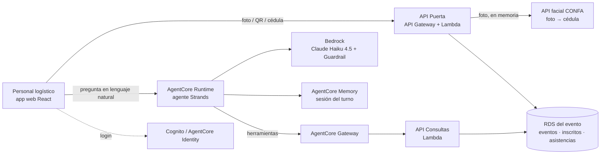
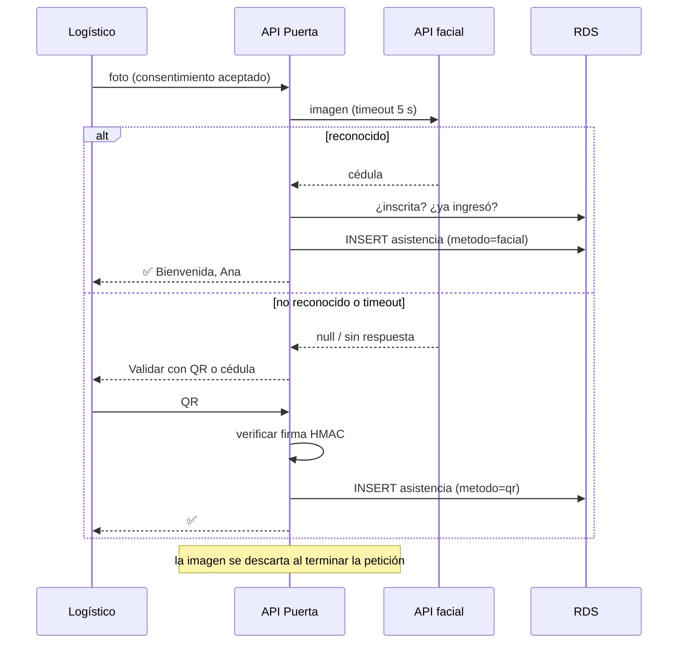

> **Borrador de referencia** preparado antes del evento. La spec oficial se genera en Kiro durante la hackathon en `.kiro/specs/pase-confa/`, usando este archivo como insumo.

# Diseño: Pase CONFA

## Resumen
Una aplicación web para el personal logístico, con dos caminos separados a propósito:
- **La puerta es código, no IA.** Foto → API facial → RDS → marcar asistencia. Es determinista, debe tardar segundos y no puede depender de un LLM.
- **El asistente es un agente.** Un solo agente Strands en AgentCore Runtime responde preguntas sobre la asistencia y crea eventos desde lenguaje natural, siempre con cifras sacadas de los datos.

## Arquitectura


## Componentes
| Componente | Tipo | Responsabilidad | Requisitos |
|---|---|---|---|
| App web (React + Vite) | Frontend | Pantallas: Puerta (cámara + lector QR + cédula), Tablero, Asistente, Organizador | 3, 4, 6, 7, 9 |
| API Puerta | **Código** (Lambda) | Validar por rostro, QR o documento; marcar asistencia; evitar duplicados; timeout de 5 s hacia la API facial | 3, 4, 10.1 |
| API Consultas | **Código** (Lambda) | Conteos, ausentes por grupo, ritmo de ingreso, crear evento, informe | 1, 6, 7, 8 |
| Agente "Asistente de eventos" | **Agente** (Strands en AgentCore Runtime) | Entender preguntas, llamar consultas, redactar respuestas; proponer eventos desde una frase | 1, 6 |
| Generador de QR | **Código** | Token firmado con HMAC (`evento|cédula|nonce`); secreto en Secrets Manager | 2 |
| Foto grupal | **Código** + Amazon Rekognition | `DetectFaces` → recortes → API facial por rostro | 5 |
| RDS | Datos | Eventos, inscritos, asistencias, personal | todos |

## Dónde NO usamos IA (y por qué)
| Parte | Por qué es código |
|---|---|
| Validación en la puerta | La latencia manda (objetivo: 3 s) y siempre se hace lo mismo. Un LLM agregaría segundos y variabilidad |
| Validación del QR | Es criptografía (firma HMAC), no interpretación |
| Conteos y ausentes | Son consultas SQL exactas. El agente nunca "calcula" cifras: las pide a una herramienta |

## Agentes
**Un solo agente.** No hay ninguna razón para un segundo: un solo modelo basta, los permisos son los mismos y el prompt es corto. *(Alternativa descartada: un orquestador con especialistas de consultas y creación; agregaría latencia y costo sin mejorar el resultado.)*

- **Patrón:** agente único con herramientas.
- **Modelo:** Claude Haiku 4.5, temperatura 0.
- **Herramientas** (expuestas por AgentCore Gateway desde la API Consultas; plan B: `@tool` que llama la API por HTTP):
  - `contar_asistencia(evento_id) -> {ingresados, inscritos, porcentaje, por_metodo}`
  - `ausentes_por_grupo(evento_id, empresa) -> list[str]` (nombres, sin cédula)
  - `ritmo_ingreso(evento_id, minutos) -> {ingresos_por_minuto, estimado_fin}`
  - `crear_evento(propuesta: EventoPropuesto) -> evento_id` (solo después de que el usuario confirme)
- **Salida estructurada:** `EventoPropuesto(nombre, fecha, hora, lugar, tipo, cupo)` para el requisito 1.
- **System prompt (resumen):** "Eres el asistente de eventos de CONFA. Respondes en español, breve, con el tono 'Contigo, con todo'. Toda cifra sale de una herramienta; nunca la estimes. Solo hablas de los eventos asignados al usuario. Nunca muestres números de cédula completos."

## Modelos
| Tarea | Modelo | Justificación |
|---|---|---|
| Asistente conversacional (consultas + crear evento) | **Claude Haiku 4.5** | Buen manejo de herramientas y buen español con baja latencia; las preguntas son de consulta, así que Sonnet no mejora el resultado y sí aumenta costo y latencia |
| Validación en la puerta | **Ninguno** | Determinista; ver "Dónde NO usamos IA" |
| Detectar rostros en foto grupal | **Amazon Rekognition** `DetectFaces` | Es visión por computador, no lenguaje; un LLM sería más lento y menos preciso |
| Redactar el resumen del informe de cierre | **Amazon Nova Micro** | Un párrafo a partir de cifras ya calculadas: el modelo más barato basta |

*Confirmar en el kickoff que la cuenta del evento tiene habilitados Haiku 4.5 y Nova Micro; alternativas: Claude Haiku 5.5, Nova Lite.*

## AgentCore
| Pieza | Uso | Por qué |
|---|---|---|
| **Runtime** | Ejecuta el agente | Serverless, una microVM aislada por sesión: la conversación de un logístico no toca la de otro |
| **Memory** | Memoria de corto plazo de la sesión (el turno de puerta) + estrategia `SUMMARIZATION` | Permite preguntas encadenadas ("¿y de Café Caldas?"). Retención de **3 días** (`eventExpiryDuration: 3`); **nunca** guarda imágenes ni cédulas completas |
| **Gateway** | Expone la API Consultas (y luego la API facial) como herramientas MCP | Una sola puerta autenticada para las herramientas; otros agentes de CONFA podrán reutilizarlas |
| **Identity** | Valida el JWT de Cognito del personal al invocar el Runtime | Requisito 9: acceso rápido y seguro, sin contraseñas compartidas |
| **Observability** | Trazas en CloudWatch | En la demo se muestra cómo razonó el agente |

## Datos (RDS PostgreSQL)
```
eventos(id, nombre, fecha, hora, lugar, tipo['inscripcion'|'interno'|'documento'], cupo, registro_en_sitio bool, estado)
inscritos(evento_id, cedula, nombre, empresa, es_menor bool, qr_nonce, PRIMARY KEY(evento_id, cedula))
asistencias(evento_id, cedula, hora, metodo['facial'|'qr'|'documento'|'grupal'], puerta, validado_por,
            UNIQUE(evento_id, cedula))                -- evita duplicados (3.5)
personal(email, nombre)            personal_eventos(email, evento_id)        -- requisito 9.2
```
No hay columnas de imagen (10.1).

**Contrato del mock de la API facial** (se reemplaza por la real en el kickoff):
`POST /reconocer {"imagen": "<base64>"} → 200 {"cedula": "1053800001" | null, "confianza": 0.97}`

## Flujos


## Seguridad
1. **Minimización:** la foto vive solo en memoria durante la petición; no se escribe en RDS, logs ni la memoria del agente.
2. **Herramientas con mínimo dato:** `ausentes_por_grupo` devuelve nombres, no cédulas; las consultas filtran por los eventos asignados al usuario (`personal_eventos`).
3. **Identidad:** login con Cognito; JWT validado en API Gateway y en el Runtime; roles de IAM por Lambda con permisos mínimos.
4. **Guardrail de Bedrock** en el agente: ataques de prompt; PII con regex de cédula (`\b\d{6,10}\b`) en modo enmascarar; tema denegado "información biométrica de personas"; temas fuera del evento.
- **Consentimiento:** aviso antes de la cámara, con el botón "Prefiero QR".
- **Menores (preescolar):** `inscritos.es_menor = true` → la cámara se desactiva para esa persona; valida el QR o el documento del acudiente.
- **Retención:** asistencias por el tiempo que defina CONFA; memoria del agente 3 días.

## Manejo de errores
| Falla | Comportamiento |
|---|---|
| API facial lenta o caída | Timeout de 5 s → QR o documento, sin bloquear la fila |
| RDS no disponible | Mensaje claro; la puerta pasa a modo "anotar cédula" en el navegador y sincroniza después (Deseable) |
| El agente no tiene la cifra | Lo dice; no la inventa (6.1) |
| QR inválido o usado | Rechazo con el motivo (2.3) |

## Estrategia de pruebas
| Qué | Tipo |
|---|---|
| API Puerta: facial ok, no reconocido, no inscrito, duplicado, timeout, menor | **pytest con TDD** (mock de la API facial y RDS con SQLite o testcontainers) |
| QR: generar, verificar, alterado, de otro evento, ya usado | **pytest con TDD** |
| Herramientas de consulta | **pytest con TDD** |
| Agente: "¿cuántos han entrado?" → `contar_asistencia`; "¿quién falta de X?" → `ausentes_por_grupo`; pregunta fuera de tema → rechazo; no revela cédulas | **Casos de evaluación** (`@pytest.mark.eval`) |
| Frontend | Verificación manual en la demo |

## Decisiones y alternativas descartadas
| Decisión | Alternativa descartada | Por qué |
|---|---|---|
| Puerta sin LLM | Agente que valida en la puerta | Latencia y variabilidad en el punto más crítico |
| Un agente | Orquestador + especialistas | Sin razón de modelo, permisos o prompt para separar |
| Haiku 4.5 | Sonnet | Consultas simples; Sonnet es más caro y lento sin mejorar el resultado |
| Gateway para herramientas | `@tool` con SQL directo dentro del agente | Gateway da autenticación y reutilización; el `@tool` HTTP queda como plan B |
| QR con HMAC | QR con solo la cédula | Evita falsificación y reutilización |

## Preguntas probables del jurado
1. **¿Por qué no usan IA en la puerta?** Porque ahí manda la velocidad y siempre se hace lo mismo; la IA está donde agrega valor: entender preguntas y crear eventos.
2. **¿Dónde viven los datos biométricos?** En ningún lado de nuestra solución: la foto pasa en memoria a la API de CONFA y se descarta; guardamos solo la cédula, la hora y el método.
3. **¿Qué pasa si la API facial falla?** A los 5 s la pantalla ofrece QR o cédula; la fila no se detiene.
4. **¿Por qué Haiku?** Las preguntas son consultas con herramientas; Haiku las resuelve igual de bien que Sonnet, más rápido y más barato.
5. **¿Qué recuerda el agente y por cuánto tiempo?** La conversación del turno de puerta, 3 días; nunca imágenes ni cédulas completas.
