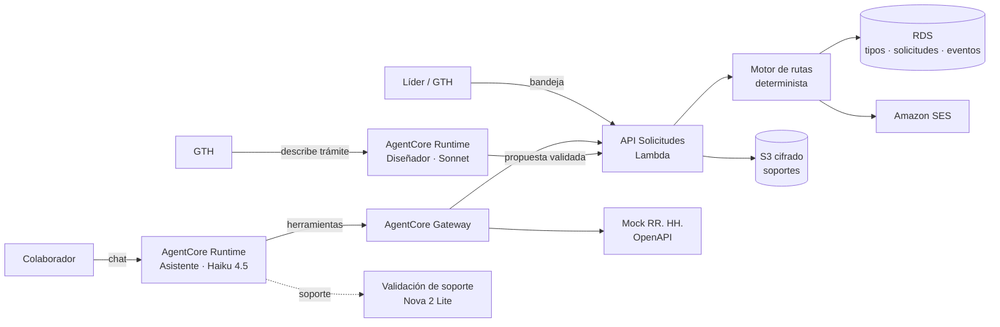

> **Borrador de referencia** preparado antes del evento. La spec oficial se genera en Kiro durante la hackathon en `.kiro/specs/mi-tramite/`, usando este archivo como insumo.

# Diseño: Mi Trámite CONFA

## Resumen
La clave del diseño: **la ruta de aprobación es un dato, no código**. Cada tipo de trámite es una configuración JSON validada contra un esquema; un motor determinista la interpreta. Así GTH crea trámites nuevos sin programar y nada depende de que un LLM "decida" una aprobación.

- **Motor de rutas:** código determinista que interpreta la configuración (sin IA).
- **Asistente del colaborador:** agente que entiende la petición, valida reglas con herramientas y radica tras confirmar.
- **Diseñador de trámites:** agente que convierte la descripción de GTH en una configuración que GTH revisa y publica.

## Arquitectura


## Componentes
| Componente | Tipo | Responsabilidad | Requisitos |
|---|---|---|---|
| App web (React) | Frontend | Mi Trámite (chat + mis solicitudes con línea de tiempo), Bandeja, Configurador GTH | 1, 5, 6, 8 |
| API Solicitudes | **Código** (Lambda) | Radicar, consultar, aprobar/rechazar, publicar trámites | 1.5, 5, 6, 8.4 |
| Motor de rutas | **Código** (función pura) | `siguiente_paso(config, solicitud, decision)`; escalamiento por condición | 4 |
| Asistente del colaborador | **Agente** | Entender, preguntar lo que falta, validar reglas, radicar tras confirmar, responder estados | 1, 2, 3, 6.3 |
| Validación de soporte | **Código + modelo** (herramienta) | Extraer solo fechas, entidad y firma de la imagen | 3.1, 3.2, 3.3 |
| Diseñador de trámites | **Agente** | Descripción → `TramiteConfig` validada; nunca publica | 8.1-8.3 |
| Notificador | **Código** | Correo por cambio de estado (SES; buzón simulado en local) | 7 |
| Mock RR. HH. | Mock (OpenAPI) | Colaborador, líder, días disponibles | 2.1 |

## Dónde NO usamos IA
| Parte | Por qué es código |
|---|---|
| Ejecutar la ruta de aprobación | Es una regla de negocio y debe ser auditable; un LLM no aprueba nada (10.3) |
| Validar días disponibles y fechas | Cálculo exacto contra el mock |
| Estado de una solicitud | Sale de la tabla de eventos (6.3), nunca del modelo |
| Publicar un trámite | Solo con el clic de GTH, después de validar el esquema (8.2, 8.3) |

## Agentes
**Dos agentes independientes**, cada uno con su propio punto de entrada. Se justifica separarlos porque tienen **usuarios, permisos y modelos distintos**: el asistente lo usan 1.200 colaboradores y solo radica y consulta lo propio; el diseñador lo usa GTH, puede proponer trámites y necesita razonamiento más complejo. *(Alternativas descartadas: un orquestador con especialistas por tipo de trámite, porque el tipo de trámite es un dato, no un agente; y un Graph para la radicación, porque los pasos ya son deterministas dentro de las herramientas.)*

### Asistente del colaborador
- **Modelo:** Claude Haiku 4.5, temperatura 0.
- **Herramientas** (el colaborador sale del JWT; ninguna recibe `colaborador_id`):
  - `tramites_disponibles() -> list[TramiteResumen]`
  - `dias_disponibles() -> int`
  - `validar_soporte(adjunto_id) -> {completo, faltantes, fecha_inicio, fecha_fin, entidad}` (sin diagnóstico)
  - `radicar_solicitud(tipo, campos, adjunto_id?) -> radicado` (solo tras confirmación del usuario)
  - `estado_de_mis_solicitudes(radicado?) -> list[LineaDeTiempo]`
- **System prompt (resumen):** rol de asistente de GTH; tono cálido y profesional sin lemas; texto plano, máximo 3 frases, sin emojis; toda cifra y estado salen de herramientas; confirmar antes de radicar; nunca hablar de diagnósticos ni de otras personas.

### Diseñador de trámites
- **Modelo:** Claude Sonnet (4.6 o 5, según lo habilitado), temperatura 0.
- **Salida estructurada:** `TramiteConfig` (Pydantic) con `nombre`, `campos[]`, `adjuntos_requeridos[]`, `ruta[]` (pasos: `lider` | `gth` | `area:<nombre>`), `condiciones[]` (por ejemplo `dias_habiles > 10 → agregar gth`).
- **Herramientas:** `tramites_existentes()` (para no duplicar) y `proponer_tramite(config)`, que guarda un **borrador**; publicar es una acción de GTH en la pantalla.

## Modelos
| Tarea | Modelo | Justificación |
|---|---|---|
| Conversar con el colaborador y usar herramientas | **Claude Haiku 4.5** | Muchas conversaciones cortas: baja latencia y costo con buen español y manejo de herramientas |
| Leer el soporte de incapacidad | **Amazon Nova 2 Lite** | Necesita leer imágenes; el multimodal más barato basta para extraer 4 campos |
| Convertir la descripción de GTH en una configuración | **Claude Sonnet** | Única tarea de razonamiento complejo (rutas y condiciones); se usa pocas veces al mes |
| Ejecutar rutas, validar reglas | **Ninguno** | Determinista y auditable |

## AgentCore
| Pieza | Uso | Por qué |
|---|---|---|
| **Runtime** | Dos runtimes en el mismo proyecto: `asistente` y `disenador` | Aislamiento por sesión y permisos distintos por agente |
| **Memory** | Asistente: `SUMMARIZATION` y `USER_PREFERENCE`, retención de 30 días | Recordar el contexto del colaborador ("como la vez pasada, del 15 al 26"); **nunca diagnósticos**: el soporte se procesa en la herramienta y la respuesta solo dice "completo/incompleto" |
| **Gateway** | Targets: API Solicitudes y mock de RR. HH. (OpenAPI) | Las APIs se vuelven herramientas MCP con autenticación; cuando exista la plataforma real, solo cambia el target |
| **Identity** | JWT de Cognito con el rol (colaborador, aprobador, GTH) | La identidad la pone la sesión, no el chat (9.2) |
| **Observability** | Trazas en CloudWatch | Mostrar en la demo qué herramientas usó el asistente |

## Datos (RDS PostgreSQL)
```
tipos_tramite(id, nombre, version, config_json, estado['borrador'|'publicado'], creado_por, publicado_en)
solicitudes(radicado, tipo_id, tipo_version, colaborador_id, campos_json, adjunto_key, estado, paso_actual, creada_en)
eventos_solicitud(radicado, momento, actor, accion, estado_nuevo, comentario)      -- trazabilidad (6.1)
aprobaciones_pendientes(radicado, aprobador_id, paso, desde)                      -- bandeja (5.1)
```
Sin columna de diagnóstico (3.3). Las solicitudes guardan la `tipo_version` con la que se radicaron: cambiar un trámite no altera las que ya están en curso.

**Contrato del mock de RR. HH.:** `GET /colaboradores/{id} → {id, nombre, correo, lider_id, area}` · `GET /colaboradores/{id}/vacaciones → {dias_disponibles}` · `GET /aprobadores?rol=gth|area=<nombre> → [{id, nombre, correo}]` · `GET /festivos?anio=2026 → [fechas]`.

**Identidad:** en el bloque 1 se simula con un usuario de prueba firmado en la sesión; en el bloque 4 la reemplaza Cognito. En los dos casos las herramientas leen la identidad de la sesión, nunca del chat.

## Flujos
```mermaid
sequenceDiagram
  participant C as Colaborador
  participant A as Asistente
  participant API as API + Motor
  participant L as Líder
  C->>A: "Vacaciones del 15 al 26 de diciembre"
  A->>API: dias_disponibles()
  A-->>C: Tienes 15 días; pides 8 hábiles (el 25 es festivo). ¿Radico?
  C->>A: Sí
  A->>API: radicar_solicitud(vacaciones, fechas)
  API->>API: ruta = config(vacaciones) → [lider]
  API-->>L: correo + bandeja
  L->>API: aprobar
  API-->>C: correo "Aprobada" + línea de tiempo actualizada
```

## Seguridad
1. **Minimización:** del soporte solo se extraen fechas, entidad y firma; el archivo va a S3 con cifrado KMS y acceso solo para el rol GTH.
2. **Herramientas con alcance fijo:** el colaborador sale del JWT; ninguna herramienta recibe a otra persona; la bandeja filtra por aprobador.
3. **Identidad:** Cognito con roles; JWT validado en API Gateway y en el Runtime; IAM mínimo por Lambda.
4. **Guardrail de Bedrock:** tema denegado "diagnósticos médicos" y "datos de otros colaboradores"; regex de cédula en modo enmascarar; ataques de prompt.
- **Humano en el ciclo:** los agentes proponen y radican tras confirmación; aprobar y publicar siempre lo hace una persona.
- **Retención:** memoria del asistente 30 días; eventos de solicitud según la política de CONFA.

## Manejo de errores
| Falla | Comportamiento |
|---|---|
| Mock de RR. HH. caído | El asistente lo dice y permite radicar; la regla de días se valida al aprobar |
| Soporte ilegible | Pide una foto más clara (3.2) |
| Configuración propuesta inválida | El diseñador la corrige o explica por qué no puede; nunca se guarda una inválida (8.2) |
| Aprobador sin respuesta | Recordatorio a las 24 h (Deseable, req. 12) |

## Estrategia de pruebas
| Qué | Tipo |
|---|---|
| Motor de rutas: solo líder, líder + GTH, escalamiento > 10 días, rechazo, versión del trámite | **pytest con TDD** |
| Reglas: días insuficientes, fechas invertidas | **pytest con TDD** |
| Esquema `TramiteConfig`: válidas e inválidas | **pytest con TDD** |
| Bandeja y consultas: cada quien ve solo lo suyo; el aprobador no ve diagnóstico | **pytest con TDD** |
| Asistente: radica solo tras confirmar; pregunta lo que falta; no habla de otros; no revela cédulas | **Casos de evaluación** |
| Diseñador: "permiso por estudio, líder y luego GTH, con certificado" → configuración esperada | **Caso de evaluación** |
| Validación de soporte | Caso de evaluación con 2 imágenes ficticias (completa e incompleta) |

## Decisiones y alternativas descartadas
| Decisión | Alternativa descartada | Por qué |
|---|---|---|
| Ruta como dato + motor determinista | Un agente que decide la ruta | Auditable, predecible y sin LLM en una decisión de negocio |
| Motor propio en Lambda | AWS Step Functions | En día y medio, un intérprete probado con TDD es más seguro; Step Functions queda como evolución (Think Big) |
| Dos agentes independientes | Un orquestador con especialistas | Usuarios, permisos y modelos distintos; el tipo de trámite es un dato |
| Validación de soporte como herramienta | Un tercer agente | Es una extracción puntual, no una conversación |

## Preguntas probables del jurado
1. **¿Cómo crea GTH un trámite sin programar?** Lo describe en palabras; el diseñador propone una configuración validada contra un esquema; GTH la revisa y publica; el motor la ejecuta sin código nuevo.
2. **¿El agente aprueba solicitudes?** Nunca. Propone y radica tras confirmar; aprobar es siempre de una persona.
3. **¿Quién ve el diagnóstico?** El modelo procesa la imagen para extraer fechas, entidad y firma, pero el diagnóstico no se extrae ni se persiste (ni en base de datos, ni en memoria, ni en logs). El líder solo ve tipo y fechas; el archivo cifrado solo lo abre el rol GTH, como hoy.
4. **¿Por qué dos agentes?** Usuarios, permisos y modelos distintos; todo lo demás es código.
5. **¿Qué pasa si cambian un trámite con solicitudes en curso?** Cada solicitud guarda la versión con la que se radicó.
